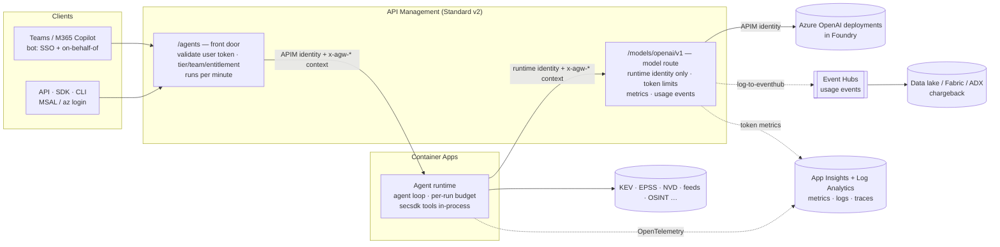
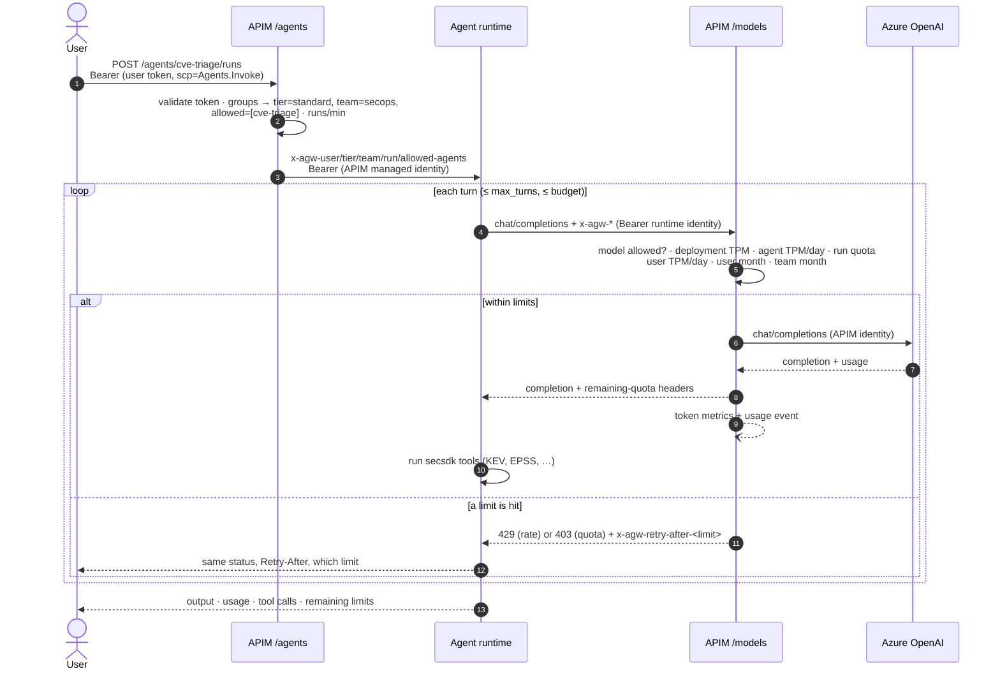

# Agent gateway on Azure: proposal

!!! abstract "Status: proposal, validated in a pilot (24 October 2026)"
    This page is the architecture and design proposal for running secsdk-powered agents
    **as a service** behind Azure API Management (APIM). It covers per-user and per-group
    token limits, entitlements and visibility.

    The implementation is in [`deploy/agent-gateway/`](https://github.com/Lariat-Labs/security-tools-sdk/tree/main/deploy/agent-gateway):
    a policy generator, Bicep, an agent runtime, a dashboard and Entra setup. It was
    deployed end to end to a pilot subscription; see [Pilot results](#pilot-results).

## Summary

Users in Microsoft Entra ID call agents through one APIM gateway. The gateway knows who
each user is, which **tier** and **team** they belong to, and which **agents** they may
use, all from their Entra group memberships. Every model call an agent makes goes back
through the same gateway, which enforces these limits:

- **Per user:** tokens per minute, per day and per month, set by the user's tier.
- **Per team:** a shared monthly pool, which is also the unit for chargeback.
- **Per agent:** tokens per minute and per day, plus a hard ceiling per run.
- **Per model deployment:** a gateway ceiling kept inside the quota Foundry granted you.

The agent loop runs in our own runtime (Container Apps), not in Foundry Agent Service.
That's the only way to make APIM see the end user on every model call (see [why](#why-not-foundrys-built-in-options)).

## Requirements

These came out of the discovery questions:

| Topic | Decision |
|---|---|
| Consumers | Internal users, one Entra tenant |
| Agent runtime | Own runtime (Container Apps), secsdk in-process |
| Models | Azure OpenAI (GPT) deployments in Foundry, Chat Completions API |
| Limit levels | Per user, per group/team, per agent, per model deployment |
| Windows | Tokens per minute (burst), daily, monthly, and a per-run budget |
| Over the limit | Hard block: `429`/`403` with a retry time and remaining-quota headers |
| Quota assignment | Tiers by Entra group (`sg-agents-standard`, `sg-agents-power`, …) |
| Agent access | One Entra group per agent (`sg-agent-cve-triage`, …) |
| Clients | Teams / M365 Copilot (bot SSO + on-behalf-of) and API / SDK / CLI |
| Visibility | Usage dashboards, cost chargeback, metadata-only audit trail, alerts |
| Network | APIM Standard v2, public endpoint with Entra authentication |

## Why not Foundry's built-in options

Three Foundry features look like they solve this. None of them can enforce limits per end user.

| Option | What it limits | Why it isn't enough |
|---|---|---|
| **Foundry AI Gateway** (Foundry Control Plane → AI Gateway) | TPM and token quota **per project and deployment** | No per-user or per-group limits. Also, Agent Service model calls **bypass** the project's gateway by design (Microsoft Q&A, linked below) |
| **Bring your own model** (agent → APIM connection) | Whatever APIM policy you write | APIM sees the **Foundry project's** identity or key, never the end user. Chat Completions only, prompt agents only |
| **Agent Applications** (published agents) | Who may invoke (Azure RBAC on the application) | No token limits. Stateless Responses only (legacy publishing model) |

APIM's `llm-token-limit` policy does what we need. Its counter key can be any expression,
such as a user's object id from their token, and it supports a per-minute rate, a
quota per hour/day/week/month/year, or both. For it to see the user on **every** model
call, the agent loop has to run somewhere that forwards the user's context. That's our
runtime.

## Architecture



| Component | Role |
|---|---|
| **APIM `/agents` (front door)** | The only public entry point. Validates the user's Entra token (`Agents.Invoke` scope). Works out tier, team and allowed agents from the `groups` claim. Refuses users with no tier or no entitlement. Limits runs per minute. Overwrites the `x-agw-*` context headers and calls the runtime with APIM's own identity |
| **Agent runtime** | Stateless FastAPI service. Loads agent definitions (instructions, model, allowed secsdk providers, run budget). Runs the Chat Completions tool loop with secsdk operations as function tools, and sends the user context with every model call |
| **APIM `/models` (model route)** | The only route to the models. Accepts only the runtime's managed identity (`Gateway.Internal` app role). Checks the agent may use the requested model, applies every token limit, emits metrics, writes one usage event per call, then calls Azure OpenAI with APIM's identity |
| **Azure OpenAI in Foundry** | Model deployments with key auth disabled. Only APIM's identity has *Cognitive Services OpenAI User* |

Why two APIM APIs instead of one: users must never reach the models directly. The model
route trusts the `x-agw-*` headers only because just one caller can reach it: the
runtime's identity, checked by token. If users could call the model route, they could
claim any team or tier.

## Request flow



## Identity and access

### The app registration

One Entra app registration, **agent-gateway**, is the audience for everything.
[`entra.sh app`](https://github.com/Lariat-Labs/security-tools-sdk/blob/main/deploy/agent-gateway/entra.sh) creates it:

| Setting | Value | Why |
|---|---|---|
| Identifier URI | `api://<app-id>` | Entra's default policy requires this format for new apps |
| Delegated scope | `Agents.Invoke` | Users' and clients' tokens must carry it (front door) |
| App role `Agents.User` | assigned to every tier, team and agent group | With *assignment required*, only members can get a token at all |
| App role `Gateway.Internal` | assigned to the APIM and runtime managed identities | The model route and the runtime accept only these |
| `groupMembershipClaims` | `ApplicationGroup` | Tokens list only groups assigned to this app: small tokens, no [group overage](https://learn.microsoft.com/entra/identity-platform/id-token-claims-reference#groups-overage-claim), no unrelated groups leaked |
| Access token version | 2 | |
| Pre-authorised client | Azure CLI | `az login` users can get a token without a consent prompt |

### Groups

| Kind | Example | Decides |
|---|---|---|
| Tier | `sg-agents-standard`, `sg-agents-power` | Personal TPM, daily and monthly limits. A user's tier is the **first** match in `gateway.yaml`, so list the most generous first |
| Team | `sg-team-secops`, `sg-team-itops` | Shared monthly pool and chargeback unit. Users in no team go to `default_team` |
| Agent | `sg-agent-cve-triage` | Who may run that agent |

Use **direct** membership for these groups and assign each one to the app (`entra.sh group`).
Assigning groups to an application requires Entra ID P1. For self-service and approvals,
put the groups in Entra **access packages** (Entra ID Governance) with expiry and reviews.

Group changes take effect when the user's next token is issued (typically within an hour).

### Service-to-service trust

| Caller → callee | How the callee checks it |
|---|---|
| APIM → runtime | Container Apps built-in auth: audience `api://<app-id>`, `allowedApplications` = APIM's user-assigned identity. Anything else gets `401` before the code runs |
| Runtime → APIM model route | `validate-azure-ad-token`: `client-application-ids` = runtime identity and `roles` contains `Gateway.Internal` |
| APIM → Azure OpenAI | Managed identity with *Cognitive Services OpenAI User*; the Foundry resource has local (key) auth disabled |

### Clients

**API, SDK and CLI.** Any client that can get a delegated token for
`api://<app-id>/Agents.Invoke`. For people, use `az login` (pre-authorised) or MSAL in
a public client app. For scripts acting as a person, use the same flows; there are no
API keys. [`client.py`](https://github.com/Lariat-Labs/security-tools-sdk/blob/main/deploy/agent-gateway/client.py) is a minimal example:

```bash
az login
export AGW_GATEWAY_URL=https://<apim>.azure-api.net AGW_GATEWAY_APP_ID=<app-id>
python deploy/agent-gateway/client.py list
python deploy/agent-gateway/client.py run cve-triage "Prioritise CVE-2024-3400 and CVE-2023-4966"
```

**Teams and M365 Copilot.** A bot (Azure Bot Service, Microsoft 365 Agents SDK) fronts
the gateway, not the runtime:

1. Teams SSO gives the bot a token for the **bot's** app registration on behalf of the user.
2. The bot exchanges it with the **on-behalf-of** flow (MSAL `acquire_token_on_behalf_of`)
   for `api://<gateway-app-id>/Agents.Invoke`. The bot's app needs that delegated
   permission with admin consent.
3. The bot calls `/agents/...` with that token. APIM sees the real user and groups, so
   limits and entitlements are the same as on the CLI.
4. The runtime is stateless, so the bot keeps conversation history (for example in Cosmos
   DB keyed by conversation id) and sends earlier turns as `history`.
5. Runs can take longer than a bot should wait before replying. Send a typing indicator
   or "working on it" message, then post the answer as a proactive message.

The bot itself is not in this repository yet (see [open items](#risks-and-open-items)).

## Limits

### What is enforced where

Every model call must pass **all** of these. They're evaluated in order, and the first
limit hit is the one reported.

| Level | Counter key | Window | Exceeded | Header naming the limit |
|---|---|---|---|---|
| Runs started (front door) | `runs:<oid>` | per minute | `429` | `Retry-After` |
| Deployment | `d:<deployment>` | TPM | `429` | `x-agw-retry-after-deployment` |
| Agent | `a:<agent>` | TPM + daily quota | `429` / `403` | `x-agw-retry-after-agent` |
| Run | `r:<run-id>` | quota (hard backstop) | `403` | `x-agw-retry-after-run` |
| User | `u:<oid>:<tier>` | TPM + daily quota | `429` / `403` | `x-agw-retry-after-user` |
| User | `u:<oid>:month` | monthly quota | `403` | `x-agw-retry-after-user-month` |
| Team | `t:<team>` | monthly quota | `403` | `x-agw-retry-after-team` |

Successful responses carry `x-agw-*-remaining` headers (user minute, day and month; team
month; agent day; run). The runtime returns them as `limits`. They are **estimates** that
become accurate only near a limit (in the pilot, a counter 5K tokens into a 500K month
reported 495K left while 80K had really been used). Show them as "about N left" and use
the usage events for exact figures.

### Per-run budget: two layers

1. **Runtime (soft).** Each agent definition has `budget_tokens` and `max_turns`. Before each
   model call, the runtime estimates the next prompt size and stops cleanly with
   `stop_reason: "budget_exhausted"` instead of starting a call that would overrun.
2. **Gateway (hard).** `tokens_per_run` in `gateway.yaml` is a quota on the `r:<run-id>`
   counter. It catches a runtime bug or a compromised runtime. A test enforces
   `budget_tokens ≤ tokens_per_run`.

### How the counting behaves

- **Counts are actual usage.** `estimate-prompt-tokens="false"`, so the limits use the
  `usage` block from each model response. The runtime never streams (the gateway refuses
  `stream: true`), because APIM estimates tokens for streamed calls.
- **Per-minute limits are a token bucket that can be overdrawn.** A call is let through
  whenever any allowance is left and charged when its response arrives, so one large call
  can take the bucket below zero; the next calls then get `429` until it refills. In the
  pilot, one run used 11.5K tokens within a minute against a 5K limit, and the next two
  runs were refused with `429` and retry times of about 20 seconds.
- **Concurrent bursts overshoot more.** In the pilot, 5 runs started together pushed 61K
  tokens through a 30K-per-minute limit in about 40 seconds without a single `429`, and
  the daily counter lagged by several thousand tokens before blocking. Treat per-minute
  limits as protection against sustained abuse and runaway loops, not as an exact meter;
  daily and monthly quotas did enforce (`403` with the time until the UTC reset).
- **Quota windows are fixed and UTC.** Daily resets at 00:00 UTC; monthly on the 1st.
  A run that crosses midnight UTC starts a fresh run counter; the runtime budget still applies.
- **Counters are per gateway region.** In a multi-region APIM they aren't aggregated.
  Start single-region, or divide limits per region.
- **Tier changes.** The per-minute and daily counter includes the tier, because APIM v2
  needs a consistent `tokens-per-minute` per key. Moving a user to another tier starts a
  fresh day. The monthly counter doesn't include the tier, so upgrading doesn't reset the month.
- **Only prompt and completion tokens are counted.** Cached prompt tokens count in full
  against limits. Usage events record `cachedTokens` separately for cost.

### Capacity planning against Foundry quota

Foundry grants each deployment a TPM quota per region (GlobalStandard `gpt-5-mini` in
eastus2 is 1,000K TPM on the test subscription). The gateway shares it out:

```text
deployment ceiling  (gateway, d:)  ≤  deployment capacity (Bicep)  ≤  regional quota
   400K TPM                             500K TPM                        1,000K TPM
```

- Keep the **gateway ceiling** below the deployment's capacity so the gateway returns a
  clear `429` before Azure OpenAI throttles everyone at once.
- **Overbook user TPM.** Sum of active users × tier TPM can exceed the ceiling, because
  few users peak together. Watch the deployment `429` rate and raise capacity (or add a
  second deployment behind a backend pool) when it climbs.
- **Monthly team pools** are a budget, not capacity: set them from cost targets.
- For predictable heavy use, add **provisioned throughput (PTU)** as the primary backend
  and spill over to standard deployments with an APIM backend pool and circuit breaker.
  The Bicep already sets a circuit breaker on the models backend.

## Configuration

Limits and entitlements are configuration, not code.
[`gateway.example.yaml`](https://github.com/Lariat-Labs/security-tools-sdk/blob/main/deploy/agent-gateway/gateway.example.yaml):

```yaml
runs_per_minute: 10
tiers:            # first match wins: most generous first
  - {name: power,    group_id: <guid>, tokens_per_minute: 60000, tokens_per_day: 1500000, tokens_per_month: 20000000}
  - {name: standard, group_id: <guid>, tokens_per_minute: 20000, tokens_per_day:  300000, tokens_per_month:  4000000}
teams:
  - {name: secops, group_id: <guid>, tokens_per_month: 60000000, cost_center: CC-1001}
default_team: {name: unassigned, tokens_per_month: 5000000}
agents:
  - {name: cve-triage, group_id: <guid>, deployments: [gpt-5-mini],
     tokens_per_minute: 150000, tokens_per_day: 10000000, tokens_per_run: 300000}
deployments:
  - {name: gpt-5-mini, tokens_per_minute: 400000}
```

`render_policies.py` validates the file and writes the two APIM policies:

```bash
uv run python deploy/agent-gateway/render_policies.py my-gateway.yaml
uv run python deploy/agent-gateway/render_policies.py my-gateway.yaml --check   # in CI
```

Limits are written into the policy XML as literals because APIM's `tokens-per-minute`
attribute doesn't accept expressions. Names are restricted to `a-z0-9-` because they end
up inside C# policy expressions. Environment-specific ids (tenant, app, managed
identities) stay as APIM named values (`{{agw-…}}`) that Bicep creates.

Agent behaviour lives next to the runtime, one YAML file per agent
([`runtime/agw_runtime/agents/`](https://github.com/Lariat-Labs/security-tools-sdk/tree/main/deploy/agent-gateway/runtime/agw_runtime/agents)):
instructions, model deployment, the secsdk **providers** it may call, `max_turns`,
`budget_tokens`. The platform team owns `gateway.yaml`; agent authors own the agent
files. A test checks they agree: same agents, an allowed deployment, budget within the run limit.

## Visibility

Four streams, each with a job, plus a dashboard on top:

| Stream | Where | Granularity | Use it for |
|---|---|---|---|
| **Token metrics** (`llm-emit-token-metric`, namespace `agent-gateway`) | App Insights custom metrics | Tier, Team, Agent, Deployment | Dashboards and metric alerts |
| **Usage events** (`log-to-eventhub`, one per model call) | Event Hubs → data lake / Fabric / ADX | Per call: user, team, tier, agent, run, deployment, prompt/completion/cached tokens, status | Chargeback and the authoritative per-user record |
| **Gateway and LLM logs** | Log Analytics (`ApiManagementGatewayLogs`, `ApiManagementGatewayLlmLog`) | Per request: status, latency, backend, token counts | Troubleshooting, `429`/`403` rates, cross-checks |
| **Runtime traces** (OpenTelemetry via secsdk telemetry) | App Insights | Per run: user, agent, each model call, each tool call and outcome | Audit trail, per-user views, debugging agents |

**Dashboard.** Bicep deploys an Azure Workbook, *Agent gateway* (Azure portal → Monitor →
Workbooks, or the resource group). It shows tokens by team, agent and model; token types
(cached and reasoning tokens); refused requests with the policy that refused them; a
per-user table of runs, tokens and blocks; limits hit over time; model throttling and
latency; and tool calls. Its definition is
[`infra/workbook.json`](https://github.com/Lariat-Labs/security-tools-sdk/blob/main/deploy/agent-gateway/infra/workbook.json).
APIM's own **Monitoring → Analytics → Language models** tab adds token charts from the LLM logs.

!!! warning "Why per-user data isn't in metrics"
    Azure Monitor custom metrics allow at most **5 custom dimensions**, and APIM tracks at
    most **100 values per dimension**; values beyond that are silently dropped. A user id
    dimension would break that. Per-user numbers come from usage events and runtime traces,
    which are logs and have no cardinality limit.

### Privacy: metadata only

- No prompt or completion text is stored anywhere. Bicep turns on APIM's LLM logs (token
  counts per call) but not the separate *Log prompts* / *Log completions* options;
  the runtime's spans record operation names, outcomes and token counts, not content.
  secsdk's telemetry records parameter **names** only, unless `SECSDK_TELEMETRY_CAPTURE_PARAMS=true`.
- Users are identified by Entra **object id** (`oid`), not name or email. Resolve names
  only in reports, from Microsoft Graph.
- Usage events and traces are personal data under most policies. Set Log Analytics and
  lake retention to match your policy, and restrict access to the usage table.

### Queries

Tokens by team and agent (metrics), last 7 days. APIM emits `Prompt Tokens` and
`Completion Tokens` (plus breakdowns such as `Prompt Cached Tokens` and
`Completion Reasoning Tokens`); there is no total metric:

```kusto
AppMetrics
| where TimeGenerated > ago(7d) and Name in ("Prompt Tokens", "Completion Tokens")
| extend team = tostring(Properties["Team"]), agent = tostring(Properties["Agent"])
| summarize tokens = sum(Sum) by team, agent, bin(TimeGenerated, 1d)
| render columnchart
```

Per-user activity and blocks (runtime traces):

```kusto
AppDependencies
| where TimeGenerated > ago(7d) and Name startswith "invoke_agent "
| extend user = tostring(Properties["agw.user.id"]), team = tostring(Properties["agw.team"]),
         stop = tostring(Properties["agw.stop_reason"]),
         tokens = toint(Properties["gen_ai.usage.input_tokens"]) + toint(Properties["gen_ai.usage.output_tokens"])
| summarize runs = count(), tokens = sum(tokens), budget_stops = countif(stop == "budget_exhausted"),
            failed = countif(Success == false) by user, team
| order by tokens desc
```

Chargeback from usage events, once they're in a table (for example Fabric Eventhouse or
ADX ingesting the `agw-usage` hub). Prices come from your Azure price sheet; don't hard-code them:

```kusto
let price = datatable(deployment:string, input_per_1m:real, cached_per_1m:real, output_per_1m:real)
    [ "gpt-5-mini", 0.0, 0.0, 0.0 ];   // fill in from your price sheet
AgwUsage
| where time >= startofmonth(now()) and status == 200
| lookup price on deployment
| extend cost = (promptTokens - cachedTokens) * input_per_1m / 1e6
             + cachedTokens * cached_per_1m / 1e6
             + completionTokens * output_per_1m / 1e6
| summarize tokens = sum(totalTokens), cost = round(sum(cost), 2) by team
```

To land usage events in a **data lake** with no extra compute, turn on Event Hubs
**Capture** to an ADLS Gen2 account (Avro files, partitioned by time).

### Alerts

| Alert | Source | Rule |
|---|---|---|
| A team passes 80% of its monthly pool | Usage events | Sum of `totalTokens` this month per team ÷ pool (from `gateway.yaml`) > 0.8 |
| Users blocked by a limit | Gateway logs | `ApiManagementGatewayLogs` with `LastErrorReason` in (`OpenAITokenLimitExceeded`, `OpenAITokenQuotaExceeded`), count in 15 min; runtime `chat` spans name the limit in `agw.limit` |
| Deployment saturation | Gateway logs | Share of `429` from the models backend over 5 min > 5% |
| Runaway agent | Runtime traces | `budget_exhausted` stops for one agent above normal |
| Gateway errors | Gateway logs | `5xx` rate on `/agents` |

Wire them to an action group (email, Teams, or a Logic App that opens a ticket).

## Deploy

These are the steps the pilot used.

```bash
# 1. Entra: app registration, groups (put the ids in your gateway.yaml)
cd deploy/agent-gateway
./entra.sh app                                   # prints gatewayAppId
./entra.sh group <app-id> sg-agents-standard     # repeat for tiers, teams and agents

# 2. Policies from your config, into a git-ignored folder
uv run python render_policies.py build/my-gateway.yaml --out build/policies

# 3. Infrastructure without the runtime (APIM Standard v2 takes a while)
az group create -n rg-agent-gateway -l eastus2
#    agentsPolicyXml/modelsPolicyXml default to the example policies; pass yours, e.g. in a
#    parameters JSON file generated from build/policies/*.xml (the pilot did this)
az deployment group create -g rg-agent-gateway -f infra/main.bicep \
  -p publisherEmail=<platform-team-address> gatewayAppId=<app-id> -p @build/policies.parameters.json

# 4. Let APIM and the runtime call each other (principal ids are deployment outputs)
./entra.sh grant <app-id> <apimPrincipalId> <runtimePrincipalId>

# 5. Build the runtime image from the repo root, then deploy it
cd ../..
az acr build -r <registryName> -t agw-runtime:0.1.0 -f deploy/agent-gateway/runtime/Dockerfile .
#    (or docker build --platform linux/amd64 … && az acr login -n <registryName> && docker push …)
az deployment group create -g rg-agent-gateway -f deploy/agent-gateway/infra/main.bicep \
  -p publisherEmail=<…> gatewayAppId=<app-id> -p @deploy/agent-gateway/build/policies.parameters.json \
  -p runtimeImage=<registryLoginServer>/agw-runtime:0.1.0

# 6. Try it
python client.py list
```

The image build context is the repo root, and `.dockerignore` is an allow-list
(`packages/secsdk` and the runtime only), so local files such as `.env` or `.envrc`
never reach the registry.

What the Bicep creates: user-assigned identities for APIM and the runtime, APIM
Standard v2 (named values, App Insights logger with custom metrics, Event Hubs logger,
diagnostic settings to Log Analytics, the two APIs and their policies, a models backend
with a circuit breaker), an AI Services (Foundry) account with key auth disabled and the
model deployments, Event Hubs, Container Registry, a Container Apps environment and the
runtime app with Entra-only ingress auth, the *Agent gateway* workbook, APIM LLM logs
(token counts only), plus the role assignments.

**Terraform instead of Bicep** works too: the `azurerm` provider covers nearly all of these
resources, `azapi` covers the rest (for example the Container Apps auth config and APIM's
LLM logging setting), and `azuread` can replace `entra.sh`. The rendered policy XML is
used the same way.

## Decisions and alternatives

| Decision | Chosen | Alternatives considered |
|---|---|---|
| Where the agent loop runs | Own runtime on Container Apps | **Foundry prompt agents**: less code, but APIM can't see the user on model calls, so only per-run totals could be limited (from the response's `usage`, after the fact). **Foundry hosted agents**: possible later; the runtime would need to forward the user context the same way |
| How the user reaches the model route | Runtime forwards `x-agw-*` headers, trusted because only the runtime identity can call | Forward the user's own token (needs a second credential so users can't call models directly), or have the front door sign a context JWT (stronger against a compromised runtime, more moving parts) |
| Limit enforcement | APIM `llm-token-limit` | Counting in the runtime against Redis/Cosmos: more flexible, but every runtime would have to be trusted to count |
| Quota assignment | Groups → tiers, compiled into policy | Per-user overrides in a lookup service (APIM `send-request` + cache): add when exceptions are common |
| Per-user reporting | Usage events + traces | Custom metric with a user dimension: blocked by the 100-value limit |
| APIM tier | Standard v2 | Basic v2 (no VNet integration); Premium v2 (VNet injection, multi-region) when fully private networking is required |
| Tools | secsdk in-process | The [MCP server](deploy-azure.md) behind APIM (APIM can front an existing MCP server, in preview). Useful when other platforms' agents need the same tools |

## Pilot results

Deployed to a dedicated resource group (eastus2) with low limits on 24 October 2026:
APIM Standard v2, `gpt-5-mini` (GlobalStandard, 500K TPM), the runtime on Container Apps.

| Check | Result |
|---|---|
| APIM accepts the generated policies, including `llm-token-limit` on a plain HTTP API | ✅ deployed without changes |
| Token carries only the app-assigned groups (`ApplicationGroup`) and `scp=Agents.Invoke` | ✅ |
| `GET /agents` lists only entitled agents | ✅ `cve-triage` only |
| End-to-end run (front door → runtime → model route → Azure OpenAI, live secsdk tools) | ✅ 4 model calls, 4 tool calls, ~30 s, all remaining-quota headers returned |
| Agent without entitlement | ✅ `403 not_entitled` |
| No token at the front door | ✅ `401` |
| User token sent to the model route (with forged context headers) | ✅ `401` |
| Runtime called directly, bypassing APIM | ✅ `403` from Container Apps auth |
| Azure OpenAI called directly | ✅ `401` (key auth disabled) |
| Daily quota | ✅ `403 quota_exceeded`, `limit: user`, retry ≈ time to 00:00 UTC |
| Per-minute limit, sequential use | ✅ `429 rate_limited`, retry ≈ 20 s, after one overdraw |
| Per-minute limit, 5 concurrent runs | ⚠️ overshot ~2× without a `429` (see [How the counting behaves](#how-the-counting-behaves)) |
| Remaining-quota headers | ⚠️ estimates; inaccurate far from the limit |
| Token metrics with Tier/Team/Agent/Deployment | ✅ (names are `Prompt Tokens`, `Completion Tokens`, …) |
| Usage events on Event Hubs | ✅ |
| Runtime traces with `agw.user.id`, stop reason, tool calls | ✅ |
| LLM logs with token counts and no message bodies | ✅ after enabling `largeLanguageModel` logs |
| Gateway logs name the refusing policy (`OpenAITokenQuotaExceeded`, `llm-token-limit[1]`) | ✅ |

Fixes found by the pilot (already in the code): the CLI client asks for `/.default`
(the Azure CLI credential rejects named scopes); Bicep takes environment-specific policy
XML as parameters; LLM logs and the workbook are part of the Bicep.

Not yet tested: `403 no_tier` (needs a fresh token after leaving the tier group), team and
agent quotas at their limits, and a 20-run load test.

## Risks and open items

- **Burst overshoot:** per-minute limits overshoot under concurrent load (see the pilot).
  If a hard per-minute ceiling matters, add a request-count `rate-limit-by-key` per user on
  the model route, or cap concurrent runs per user at the front door.
- **Teams bot** is designed here but not built.
- **Conversation state** is the client's job (the runtime is stateless). A shared
  conversation store would need per-user isolation.
- **Foundry Agent Service** may later support end-user identity on model calls; if it does,
  prompt agents could run behind the same model route.
- **Cost:** APIM Standard v2 and the Event Hubs namespace are fixed monthly costs; the
  runtime keeps one replica warm. Check current pricing for your region.
- **Multi-region:** counters are per region; see [How the counting behaves](#how-the-counting-behaves).

## Sources

- [llm-token-limit policy](https://learn.microsoft.com/azure/api-management/llm-token-limit-policy) and [llm-emit-token-metric policy](https://learn.microsoft.com/azure/api-management/llm-emit-token-metric-policy)
- [AI gateway capabilities in Azure API Management](https://learn.microsoft.com/azure/api-management/genai-gateway-capabilities)
- [validate-azure-ad-token policy](https://learn.microsoft.com/azure/api-management/validate-azure-ad-token-policy)
- [Log token usage, prompts and completions for LLM APIs](https://learn.microsoft.com/azure/api-management/api-management-howto-llm-logs)
- [Enforce token limits for models (Foundry Control Plane)](https://learn.microsoft.com/azure/foundry/control-plane/how-to-enforce-limits-models)
- [Bring your own model to Foundry Agent Service](https://learn.microsoft.com/azure/foundry/agents/how-to/ai-gateway)
- [Does Agent Service route model calls through AI Gateway? (Microsoft Q&A)](https://learn.microsoft.com/answers/questions/5777255/azure-ai-foundry-does-ai-agent-service-route-model)
- [Agent applications in Microsoft Foundry](https://learn.microsoft.com/azure/foundry/agents/how-to/agent-applications)
- [Expose and govern an existing MCP server with API Management](https://learn.microsoft.com/azure/api-management/expose-existing-mcp-server)
