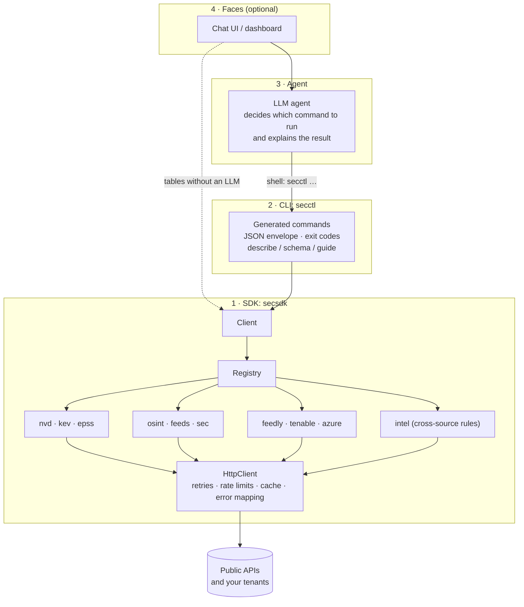
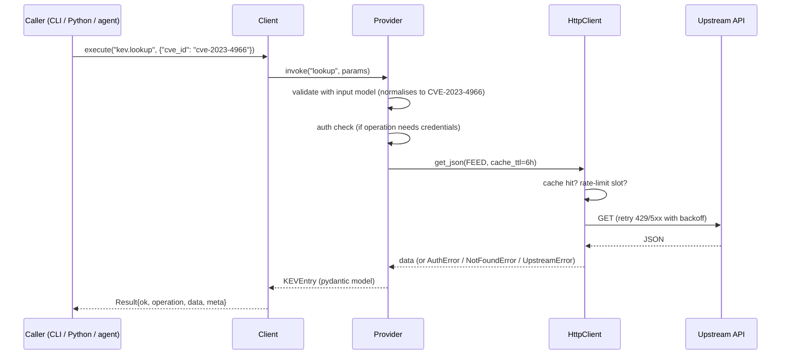

# Architecture

## Layers



| Layer | Contains | Testable without an LLM? |
|---|---|---|
| **SDK** | All fetching, parsing, validation, scoring | Yes, unit tests with mocked HTTP |
| **CLI** | Argument parsing, output formatting, exit codes | Yes, CLI contract tests |
| **Agent** | Choosing commands, judgement, explanation | Run the same CLI commands by hand |
| **Face** | Presentation | Swap it out at any time |

**Rule of thumb:** if a step has a correct answer, it belongs in the SDK. If it
needs judgement ("which of these should we fix first, and why?"), it belongs to
the agent.

`intel.cve_priority` is an example. The *scoring rules* (KEV → P1, EPSS ≥ 0.5 → P2, …)
are a pure function in the SDK with a test for each rule. The agent never
computes priority itself. It explains what the SDK returned.

## Inside the SDK

### Operations

An **operation** is a provider method decorated with `@operation`:

```python
class KEV(Provider):
    name = "kev"

    @operation(examples=["secctl kev lookup CVE-2023-4966"])
    def lookup(self, cve_id: CveId) -> KEVEntry:
        """Return the KEV entry for a CVE."""
```

From that one declaration the SDK derives:

- a **pydantic input model** built from the signature, used to validate every call
  the same way, whether it comes from Python, the CLI or an agent;
- a **name**, `kev.lookup`, used by `client.call(...)`, `secctl call ...` and tool schemas;
- **CLI help** (docstring), **examples**, a **JSON schema**, and an entry in the
  generated [operations reference](reference/operations.md).

### Request lifecycle



### Errors

Every failure is a subclass of `SecSDKError` with a stable `code` and an `exit_code`:

| Exception | `code` | Exit | Typical cause |
|---|---|---|---|
| `InvalidInputError` | `invalid_input` | 2 | Bad CVE id, bad domain, unknown parameter |
| `UnknownOperationError` | `unknown_operation` | 2 | Typo in operation name |
| `ConfigError` | `not_configured` | 3 | Missing API key or settings |
| `AuthError` | `auth_failed` | 3 | Upstream returned 401/403 |
| `UpstreamError` | `upstream_error` | 4 | 5xx, bad payload, network failure |
| `RateLimitedError` | `rate_limited` | 4 | Still 429 after retries |
| `NotFoundError` | `not_found` | 5 | CVE not in KEV, unknown domain |

Errors carry a `hint` (what to do next) wherever one is known. Agents use hints well.

### Shared HTTP behaviour

All providers go through `secsdk.http.HttpClient`, so every source gets:

- retries with exponential backoff on 429/5xx and network errors (honours `Retry-After`);
- **client-side rate limits** per provider, matching each API's published limits
  (NVD 5 per 30s without a key, SEC 10/s, Resource Graph 15 per 5s, …);
- an opt-in **file cache** for public, slow-changing data (KEV catalog, SEC ticker map,
  CT results). Authenticated responses are never cached;
- mapping of HTTP status codes to the error types above.

### Discovery

`Registry` loads providers from two places:

1. every public module in `secsdk/providers/` (built-ins), and
2. installed packages exposing the `secsdk.providers` entry-point group (plugins).

The CLI, docs and tool schemas all read the registry, so **adding a provider
module is the only step needed** to make it available everywhere. See
[Extending the SDK](extending.md).
