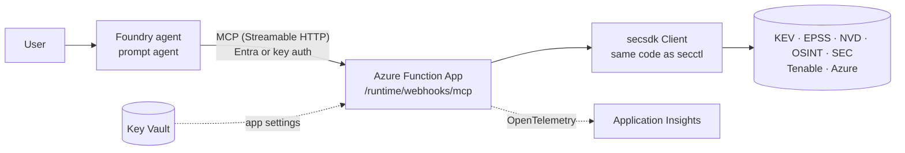

# Deploy to Azure: MCP server for Foundry agents

Foundry agents can't run a CLI, but they can call **MCP servers**. This guide hosts
secsdk as a **remote MCP server on Azure Functions** (the Functions MCP extension) and
connects it to a **Microsoft Foundry** agent.



## Why MCP mirrors the CLI

The MCP tools are the CLI's verbs, so the agent rules you wrote for `secctl` carry over:

| MCP tool | Equivalent CLI |
|---|---|
| `secsdk_guide` | `secctl guide` |
| `secsdk_providers` | `secctl providers` |
| `secsdk_describe(operation)` | `secctl describe <op>` |
| `secsdk_call(operation, params)` | `secctl call <op> --params '{…}'` |
| `intel_cve_priority`, `kev_lookup`, `osint_profile`, `feeds_news` | shortcuts for common tasks |

Every tool returns the **same JSON envelope** as `secctl`. The Function App calls the SDK in
process rather than running the CLI, so there's no subprocess per call and connection pools
and caches are shared. Behaviour is identical because the CLI and the Function App both
go through `Client.execute`.

Adding a provider to the SDK makes it available through `secsdk_call` on the next deploy,
with no changes to the Function App.

## What's in `deploy/`

```text
deploy/
  azure-functions/
    function_app.py              # MCP tool definitions (azure-functions >= 2.3, Python 3.13)
    mcp_tools.py                 # tool logic, unit-tested without the Functions runtime
    host.json                    # MCP server name/instructions, OpenTelemetry mode
    build.sh                     # builds the secsdk wheel + requirements.txt
    local.settings.example.json
    tests/
  foundry/
    create_agent.py              # creates a Foundry prompt agent wired to the MCP server
```

## 1. Run locally

Requires [Azure Functions Core Tools](https://learn.microsoft.com/azure/azure-functions/functions-run-local)
v4, Python 3.13, and [Azurite](https://learn.microsoft.com/azure/storage/common/storage-use-azurite)
for local storage.

```bash
cd deploy/azure-functions
./build.sh                                   # wheels/ + requirements.txt
cp local.settings.example.json local.settings.json
python3.13 -m venv .venv && . .venv/bin/activate && pip install -r requirements.txt
azurite --silent &                           # or the VS Code Azurite extension
func start
```

The MCP endpoint is `http://localhost:7071/runtime/webhooks/mcp` (no key locally). Test it with
MCP Inspector (`npx @modelcontextprotocol/inspector`, transport *Streamable HTTP*) or by
adding it as an MCP server in VS Code.

## 2. Deploy (dev: key auth)

The quickest path uses a Flex Consumption app with the `mcp_extension` system key:

```bash
RG=rg-secsdk-mcp LOC=eastus2 APP=secsdk-mcp-$RANDOM ST=stsecsdk$RANDOM

az group create -n $RG -l $LOC
az storage account create -n $ST -g $RG -l $LOC --sku Standard_LRS --allow-blob-public-access false
az functionapp create -g $RG -n $APP --storage-account $ST \
  --flexconsumption-location $LOC --runtime python --runtime-version 3.13
az functionapp identity assign -g $RG -n $APP           # system-assigned managed identity

az functionapp config appsettings set -g $RG -n $APP --settings \
  SECSDK_SEC_USER_AGENT="Your Org security@your-org.example" \
  SECSDK_TIMEOUT=45 \
  PYTHON_APPLICATIONINSIGHTS_ENABLE_TELEMETRY=true

cd deploy/azure-functions && ./build.sh
func azure functionapp publish $APP

# Endpoint + key for clients (sent as the x-functions-key header)
echo "https://$APP.azurewebsites.net/runtime/webhooks/mcp"
az functionapp keys list -g $RG -n $APP --query systemKeys.mcp_extension -o tsv
```

!!! info "Packaging"
    secsdk isn't on PyPI, so `build.sh` builds a wheel into `wheels/` and points
    `requirements.txt` at it. The remote build installs it like any other package.
    If you publish secsdk to a private feed (Azure Artifacts), replace the wheel line
    with `secsdk[azure]==<version>`.

## 3. Production: Entra auth, secrets and scope

**Authentication.** For production, turn off key auth and enable the Functions
**built-in MCP authorization** with Microsoft Entra. Foundry then authenticates as the
agent's own identity (recommended) or the project's managed identity. Microsoft's
[remote-mcp-functions-python](https://github.com/Azure-Samples/remote-mcp-functions-python)
template provisions this (Entra app registration, Easy Auth, `webhookAuthorizationLevel:
Anonymous` behind it). Follow
[Connect an MCP server on Azure Functions to Foundry Agent Service](https://learn.microsoft.com/azure/azure-functions/functions-mcp-foundry-tools)
and [Set up MCP server authentication (Foundry)](https://learn.microsoft.com/azure/foundry/agents/how-to/mcp-authentication).

**Secrets.** Store provider credentials in Key Vault and reference them from app settings,
never in code:

```bash
az functionapp config appsettings set -g $RG -n $APP --settings \
  TENABLE_ACCESS_KEY="@Microsoft.KeyVault(SecretUri=https://<kv>.vault.azure.net/secrets/tenable-access-key/)" \
  TENABLE_SECRET_KEY="@Microsoft.KeyVault(SecretUri=https://<kv>.vault.azure.net/secrets/tenable-secret-key/)"
```

Grant the app's managed identity *Key Vault Secrets User*.

**Azure data.** The `azure` provider uses the Function App's **managed identity**
automatically (`IDENTITY_ENDPOINT` is detected). Give that identity *Reader*, plus
*Security Reader* for Defender recommendations, on the subscriptions it should see. For a
user-assigned identity, set `SECSDK_AZURE_MANAGED_IDENTITY_CLIENT_ID`.

**Scope per agent.** `SECSDK_MCP_ALLOWED_PROVIDERS` limits which providers a server exposes.
Deploy separate Function Apps per trust level, for example:

| Server | `SECSDK_MCP_ALLOWED_PROVIDERS` | Consumers |
|---|---|---|
| `secsdk-public` | `kev,epss,nvd,osint,feeds,sec,intel` | any analyst agent |
| `secsdk-internal` | (all) | agents allowed to see Tenable / Azure posture |

Restrict tools further on the Foundry side with `allowed_tools`.

!!! tip "Per-user token limits"
    Foundry agents can't enforce token limits per end user. To offer agents to Entra users
    and groups with per-user, per-team and per-agent token limits, see the
    [Agent gateway proposal](agent-gateway.md).

## 4. Connect a Foundry agent

**Portal:** in your Foundry project, open the agent, **Add tool → Model Context Protocol**, and set:

| Field | Value |
|---|---|
| Name | `secsdk` |
| Remote MCP Server endpoint | `https://<app>.azurewebsites.net/runtime/webhooks/mcp` |
| Authentication | *Key-based* (header `x-functions-key`, value = `mcp_extension` key) for dev; *Microsoft Entra → Agent identity* with the app's audience (`api://<client-id>`) for production |

**Code:** `deploy/foundry/create_agent.py` creates a prompt agent with an `MCPTool`
(`server_label="secsdk"`, `allowed_tools=[…]`, `require_approval="never"` because every tool is
read-only) and optionally sends a test question:

```bash
pip install "azure-ai-projects>=2" azure-identity && az login
export FOUNDRY_PROJECT_ENDPOINT="https://<resource>.ai.azure.com/api/projects/<project>"
export FOUNDRY_MODEL="<model deployment name>"
export SECSDK_MCP_URL="https://<app>.azurewebsites.net/runtime/webhooks/mcp"
export SECSDK_MCP_CONNECTION="secsdk-mcp"   # project connection that holds the key / Entra config
python deploy/foundry/create_agent.py --ask "Prioritise CVE-2024-3400 and CVE-2023-4966"
```

The agent instructions in that script are the MCP version of [`AGENTS.md`](agents.md).

## Limits to design around

- **100-second tool timeout.** Foundry fails non-streaming MCP tool calls that take longer
  than 100 seconds. Keep `SECSDK_TIMEOUT` well below that and avoid slow operations in
  interactive agents: `osint.subdomains` (crt.sh) and `tenable.findings` (export API) can
  exceed it. For those, use Foundry **background mode** or run them on a schedule and serve cached results.
- **Result size.** Tool results over `SECSDK_MCP_MAX_CHARS` (60,000 by default) are replaced
  by a `result_too_large` error whose hint tells the agent how to narrow the query.
- **Cache.** On Functions the response cache lives in the instance's temp directory. It's
  per instance and is cleared when instances recycle.

## Telemetry

`host.json` sets `"telemetryMode": "OpenTelemetry"`, and the app setting
`PYTHON_APPLICATIONINSIGHTS_ENABLE_TELEMETRY=true` lets the platform configure Azure
Monitor in the worker. The Function App doesn't call `secsdk.telemetry.configure()`, so
the exporter isn't set up twice. secsdk's spans (`secsdk kev.lookup`, `GET www.cisa.gov`, …)
appear under each MCP tool invocation in Application Insights. See [Observability](observability.md)
for queries and data-lake export.

## Sources

- [Build a custom remote MCP server using Azure Functions](https://learn.microsoft.com/azure/azure-functions/scenario-custom-remote-mcp-server)
- [Tutorial: Host an MCP server on Azure Functions](https://learn.microsoft.com/azure/azure-functions/functions-mcp-tutorial)
- [Connect an MCP server on Azure Functions to Foundry Agent Service](https://learn.microsoft.com/azure/azure-functions/functions-mcp-foundry-tools)
- [Azure-Samples/remote-mcp-functions-python](https://github.com/Azure-Samples/remote-mcp-functions-python)
- [Azure/azure-functions-mcp-extension](https://github.com/Azure/azure-functions-mcp-extension)
- [Connect agents to MCP server endpoints (Foundry)](https://learn.microsoft.com/azure/foundry/agents/how-to/tools/model-context-protocol)
- [Set up MCP server authentication (Foundry)](https://learn.microsoft.com/azure/foundry/agents/how-to/mcp-authentication)
- [Give your Foundry Agent custom tools with MCP servers on Azure Functions](https://devblogs.microsoft.com/azure-sdk/give-your-foundry-agent-custom-tools-with-mcp-servers-on-azure-functions/)
- [Use OpenTelemetry with Azure Functions](https://learn.microsoft.com/azure/azure-functions/opentelemetry-howto)
