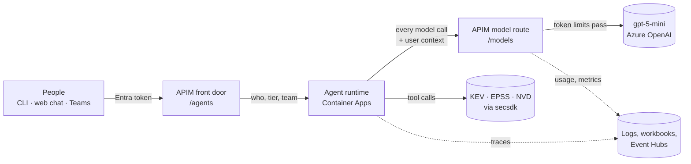

# 00 · The big picture

*What problem this solves, and the five parts that solve it.*

**The problem.** Azure gives you model capacity as a quota per deployment, for example
500,000 tokens per minute for `gpt-5-mini`. Foundry can split that quota by *project*, but
not by *person*. If you offer agents to a whole company, one person or one looping agent can
use everyone's capacity, and you can't tell who spent what.

**The fix.** Put a gateway (Azure API Management, "APIM") in the middle that knows who each
user is and counts their tokens. The agent itself runs in our own small service, so that
every model call it makes goes back through the gateway carrying the user's identity.



The five parts: people and their clients, the APIM front door, the runtime, the APIM model
route, and observability.

Agent
:   A model in a loop: it reads your question, decides to call a tool, reads the result, and
    repeats until it can answer.

Tool
:   A function the model may ask to run. Here, every tool is a read-only `secsdk` operation
    such as `kev.lookup`.

Token
:   Two different things share this word. A *model token* is a chunk of text the model reads
    or writes (the billing unit). An *access token* is a signed JWT proving who you are.

APIM
:   Azure API Management: a programmable reverse proxy. Its *policies* are small XML programs
    that run on every request.

Tenant
:   Your Microsoft Entra directory: the users, groups and app registrations that identity is
    built on.

## Steps

!!! info "Look: see everything that was deployed"
    One resource group holds the whole deployment. Skim the list: you'll meet every item in
    a later module. Open the resource group in the portal (Resource groups → `$RG`).

!!! example "Run: list the same resources from the CLI"
    ```bash
    az resource list -g $RG --query "[].{name:name, type:type}" -o table
    ```
    Expect about 20 rows: `apim-…`, `ca-…-runtime`, `ais-…` (the models), `appi-…`, `log-…`,
    `evhns-…`, three workbooks, four `id-…` identities, and the bot if you deployed Teams.

??? question "Check: why can't the agent run inside Foundry Agent Service here?"
    Because when a Foundry agent calls its model, that call never passes through your gateway
    with the end user's identity. Without the user on every model call, the gateway can't
    enforce per-person limits. Running the loop ourselves means we choose what each model
    call carries.

[Next: the SDK and CLI →](01-sdk.md)
