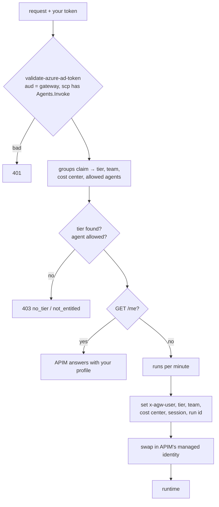

# 03 · The front door: APIM decides who you are

*The only public entry point, and the place identity becomes context.*

APIM hosts two APIs. **`/agents`** is the front door users call. Its policy validates your
token, turns your groups into a *tier*, a *team*, a *cost center* and a list of *allowed
agents*, refuses you if you have no tier or aren't entitled, limits runs per minute, then
forwards to the runtime with trusted `x-agw-*` headers and **its own** identity. Your token
never reaches the runtime.

`GET /agents/me` is answered by APIM itself from those same values: the quickest way to see
what the gateway thinks of you.



## Steps

!!! example "Run: ask the gateway who you are"
    ```bash
    uv run python deploy/agent-gateway/client.py me
    ```
    Your tier and its limits, your team and cost center, and the agents you may use.

!!! example "Run: knock without a token"
    ```bash
    curl -s -w "\nHTTP %{http_code}\n" $AGW_GATEWAY_URL/agents/
    ```
    `HTTP 401` with "Sign in with a Microsoft Entra token for the agent gateway."

!!! example "Run: read the policy that did that"
    This XML is generated from `gateway.yaml` by `render_policies.py`; nobody edits it by hand.
    ```bash
    sed -n 1,60p deploy/agent-gateway/policies/agents-api.xml
    ```
    That's the example config's policy. Your deployed one was rendered from your own
    `gateway.yaml` (for example into `deploy/agent-gateway/build/policies/`).

!!! info "Look: the same policy inside APIM"
    Open APIM (`portal "$APIM"`) → **APIs** → *Agent gateway: agents* → **All operations** →
    **Inbound processing** → `</>`. Also open **Named values**: the four `agw-…` ids the policy
    references as `{{agw-…}}`.

??? question "Check: a user sends their own `x-agw-tier: power` header. What happens?"
    Nothing useful for them. The front door overwrites every `x-agw-*` header from the token.
    And the runtime only accepts calls from APIM's identity, so the user can't skip the front
    door either.

[Next: token limits →](04-limits.md)
