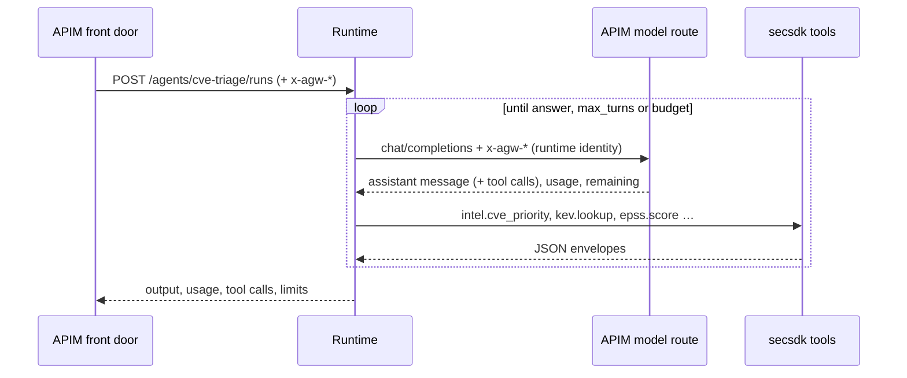

# 05 · The runtime: the agent loop itself

*A small stateless FastAPI service on Container Apps.*

Each agent is a YAML file: instructions, model, which providers it may use, `max_turns` and
a token `budget_tokens`. A run is a loop: send messages and tool definitions to the model; if
it asks for tools, run them with secsdk and append the results; stop when it answers, hits
`max_turns`, or would exceed its budget.

The runtime trusts the `x-agw-*` headers because Container Apps' built-in authentication lets
only APIM's managed identity in. It keeps no conversation state: the client sends earlier
turns as `history`.



## Steps

!!! example "Run: read an agent definition"
    ```bash
    cat deploy/agent-gateway/runtime/agw_runtime/agents/cve-triage.yaml
    ```

!!! example "Run: try to skip the gateway"
    ```bash
    curl -s -o /dev/null -w "HTTP %{http_code}\n" $RUNTIME_URL/agents/
    ```
    `HTTP 401`: refused by Container Apps authentication before the code runs.

!!! example "Run: watch the runtime's logs"
    ```bash
    az containerapp logs show -g $RG -n $(az containerapp list -g $RG --query "[?ends_with(name,'-runtime')].name | [0]" -o tsv) --tail 30
    ```

!!! info "Look: revisions and authentication"
    Open the runtime container app → **Revisions and replicas** (one revision per image you
    deployed) and **Authentication** (Microsoft provider, allowed client = APIM's identity).

??? question "Check: there are two per-run limits. Why both?"
    The runtime's `budget_tokens` stops gracefully with "budget exhausted". The gateway's run
    counter (`tokens_per_run`) is a hard backstop in case the runtime misbehaves. A test
    enforces budget ≤ backstop.

[Next: models and quota →](06-models.md)
