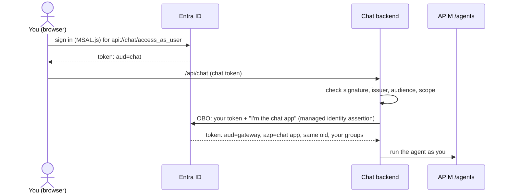

# 07 · On-behalf-of: the web chat

*How an app in the middle calls the gateway as you, without holding any secret.*

Your browser gets a token for the **chat app**, not for the gateway. The chat backend sends
that token to Entra and asks for a gateway token *for the same user*: that exchange is
**on-behalf-of (OBO)**. To prove it is the chat app, the backend doesn't use a secret. Its
managed identity gets a token for `api://AzureADTokenExchange`, and the chat app registration
has a **federated credential** that trusts exactly that identity.



!!! note "Needs the web chat"
    Skip this module if you didn't deploy the chat (`chatImage` / `chat_image` empty).

## Steps

!!! info "Look: use the web chat"
    Open `echo $CHAT_URL`, sign in, ask a CVE question, and read the side panel: your chat
    token, the OBO gateway token (same `oid`, different `aud` and `azp`), and the gateway's
    view from `/agents/me`. Note the session id: you'll use it in module 09.

!!! example "Run: get a chat-app token and compare its claims"
    ```bash
    az account get-access-token --scope "api://$CHAT_APP_ID/.default" --query accessToken -o tsv \
    | python3 -c "import sys,json,base64; p=sys.stdin.read().split('.')[1]; p+='='*(-len(p)%4); c=json.loads(base64.urlsafe_b64decode(p)); print({k:c.get(k) for k in ('aud','scp','groups','oid')})"
    ```
    Its `aud` is the chat app and it has **no groups**: groups only appear in the gateway
    token, because only the gateway app emits them.

!!! example "Run: see the federated credential, the part that replaces a secret"
    ```bash
    az ad app federated-credential list --id $CHAT_APP_ID --query "[].{name:name, issuer:issuer, subject:subject}" -o table
    az ad app credential list --id $CHAT_APP_ID -o table
    ```
    One federated credential whose subject is the chat identity's object id, and **no
    passwords**.

??? question "Check: why doesn't the browser just get a gateway token itself?"
    It could, but then any script in the page could call the gateway directly, and the
    backend couldn't add anything (session ids, its own checks). OBO keeps the gateway token
    server-side, and the gateway can tell from `azp` which front end a call came through.

!!! tip "Prefer a supported front end?"
    Copilot Studio can use the gateway's agents as connected agents over A2A, with each user
    signing in so the same limits apply. See
    [Copilot Studio (A2A)](../agent-gateway.md#copilot-studio-a2a).

[Next: the Teams bot →](08-teams.md)
