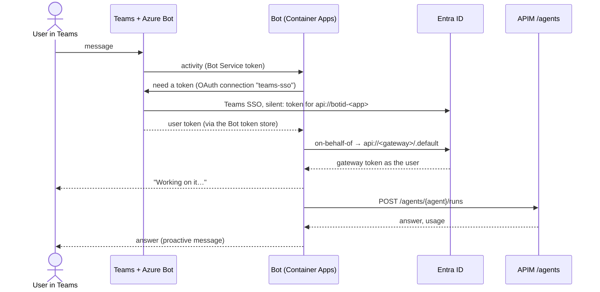

# 08 · Teams: the same pattern with SSO in front

*Another OBO middle tier, signed in silently by Teams.*

The Teams bot is another OBO middle tier. Teams SSO silently gets a token for
`api://botid-<bot app>` through the Azure Bot's OAuth connection, and the bot exchanges it
for a gateway token. The bot's app registration has two federated credentials: one trusts
the **Bot Service token store** (so the OAuth connection needs no secret) and one trusts the
**bot's managed identity** (so the bot can sign in to Bot Service and do OBO).

Runs take longer than a chat turn should, so the bot replies "Working on it…" immediately and
posts the answer later as a *proactive* message.



!!! warning "You need a licensed work account"
    Teams needs a **member** account in the gateway's tenant with a Teams licence. Guest
    accounts and personal Microsoft accounts can't upload apps, and guests can't use the
    Microsoft 365 admin center to start a trial. See [module 12](12-wrap-up.md#finish-the-teams-test).

## Steps

!!! example "Run: the bot is up and refuses strangers"
    ```bash
    curl -s $BOT_URL/healthz; echo
    curl -s -o /dev/null -w "anonymous /api/messages: HTTP %{http_code}\n" -X POST \
      -H "content-type: application/json" -d '{"type":"message"}' $BOT_URL/api/messages
    ```
    `{"ok": true}`, then `HTTP 401`.

!!! example "Run: the two federated credentials"
    ```bash
    az ad app federated-credential list --id $TEAMS_APP_ID --query "[].{name:name, subject:subject}" -o table
    ```
    `bot-token-store` (subject `/eid1/c/pub/t/…/a/9ExAW52n_ky4ZiS_jhpJIQ/agw-teams-sso`) and
    `bot-managed-identity`.

!!! info "Look: the Azure Bot, its Teams channel and OAuth connection"
    Open the Azure Bot (`bot-…`) → **Channels** (Microsoft Teams) and **Configuration → OAuth
    Connection Settings** → `teams-sso` (provider "AAD v2 with Federated Credentials").

!!! example "Run: build the Teams app package"
    ```bash
    uv run python deploy/agent-gateway/teams/package.py --app-id $TEAMS_APP_ID --bot-host ${BOT_URL#https://}
    ```
    Upload `deploy/agent-gateway/build/agent-gateway-teams.zip` in the Teams admin center
    (Teams apps → Manage apps → Upload new app), then message the bot: `me`, `agents`, or a
    CVE question.

??? question "Check: what does `webApplicationInfo` in the Teams manifest do?"
    It tells Teams which app (`api://botid-…`) to fetch an SSO token for. With it, users are
    signed in silently; without it, they'd get a sign-in card.

[Next: observability →](09-observability.md)
