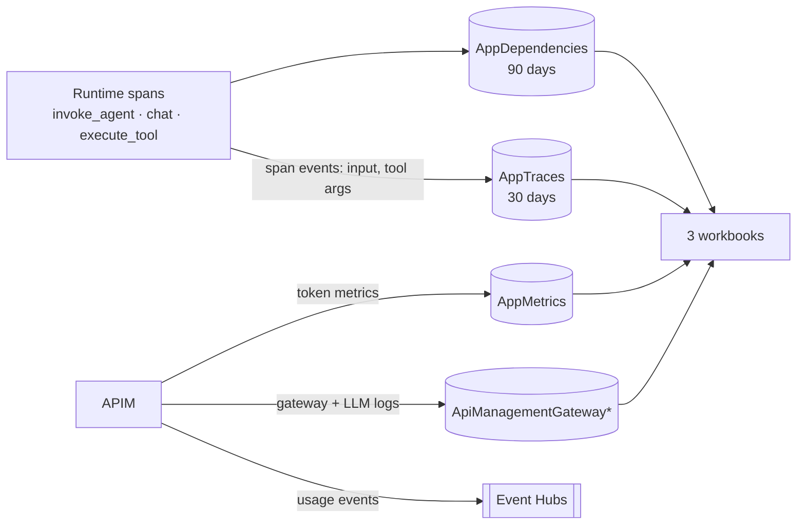

# 09 · Observability: following a run

*Four streams, three workbooks, and how to read a session step by step.*

The runtime emits OpenTelemetry **spans**: one `invoke_agent` per run, a `chat` per model
call, an `execute_tool` per tool call, plus secsdk's own spans for each upstream API call.
Spans carry metadata (who, tokens, outcome, timing) and are kept 90 days. Your question and
each tool's **arguments** are recorded as **span events**, which land in the `AppTraces`
table and are kept 30 days. Model answers and tool results are never stored.

APIM adds token **metrics** (by tier, team, agent, deployment and cost center), **gateway and
LLM logs**, and one **usage event** per model call to Event Hubs.



## Steps

!!! info "Look: the run explorer, session → run → timeline"
    Azure portal → Monitor → Workbooks → **Agent gateway: run explorer**. Click a session, then
    a run. The timeline shows your question, each model call ("model → calls
    intel_cve_priority, epss_score"), each tool call with its arguments, and the upstream API
    calls. Type `CVE-2021-44228` into **Search**. Then open **Agent gateway: tools**.

!!! info "Look: one run as a tree"
    Application Insights (`appi-…`) → **Transaction search** → filter on "invoke_agent" → open
    one. The end-to-end view nests model calls, tool calls and HTTP calls.

!!! example "Run: query the data yourself (KQL)"
    ```bash
    az monitor log-analytics query -w $LAW_ID -o table --analytics-query '
    AppTraces
    | where TimeGenerated > ago(1d) and Message == "agw.tool_arguments"
    | project TimeGenerated, tool = tostring(Properties["gen_ai.tool.name"]), args = tostring(Properties["gen_ai.tool.call.arguments"])
    | take 10'
    ```

!!! example "Run: check every workbook query still works"
    ```bash
    uv run python deploy/agent-gateway/infra/workbooks/validate.py $LAW_ID
    ```

!!! info "Look: the Foundry trace view"
    After `register_agents.py` (see [Deploy](../agent-gateway.md#deploy)), open
    [ai.azure.com](https://ai.azure.com) → project **agents** → Agents → `cve-triage` →
    **Traces**. Foundry matches spans to the agent by `gen_ai.agent.id`.

    The agents are marked **external** and show no model or tools, because Foundry only
    holds a registration: the loop runs in the gateway runtime so every model call goes
    through APIM with your identity. The description and metadata list the model, tools,
    budgets and a link to the definition. See
    [Why the agents are external in Foundry](../agent-gateway.md#why-the-agents-are-external-in-foundry).

??? question "Check: why isn't the user id a metric dimension?"
    Azure Monitor custom metrics allow 5 custom dimensions and APIM tracks at most 100 values
    per dimension, dropping the rest silently. Per-user numbers come from logs (spans and usage
    events), which have no such limit.

[Next: cost and chargeback →](10-cost.md)
