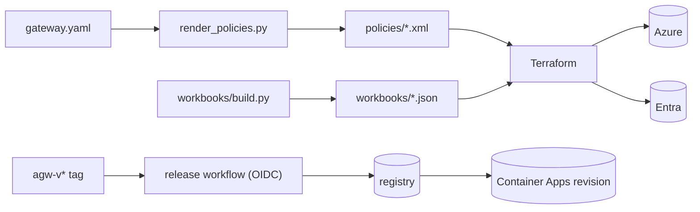

# 11 · Infrastructure as code: Terraform and releases

*How the whole thing is described, generated, deployed and released.*

Three generators feed the deployment: `render_policies.py` (gateway.yaml → APIM policy XML),
`infra/workbooks/build.py` (→ workbook JSON) and `teams/package.py` (→ Teams app zip).
**Terraform** (`terraform/`) deploys Azure and Entra in one root module: `azurerm` for
resources, `azuread` for Entra, `azapi` where azurerm can't express something exactly. After
the first images, a **GitHub Actions release workflow** builds and rolls out new images,
signed in to Azure with OIDC instead of a secret.



## Steps

!!! example "Run: regenerate policies from config"
    ```bash
    uv run python deploy/agent-gateway/render_policies.py deploy/agent-gateway/gateway.example.yaml --check \
      && echo "policies match the example config"
    ```

!!! example "Run: validate the Terraform"
    ```bash
    (cd deploy/agent-gateway/terraform && terraform init -backend=false && terraform validate)
    ```

!!! example "Run: see what Terraform would create (plan only, nothing changes)"
    ```bash
    (cd deploy/agent-gateway/terraform && terraform plan -lock=false -out=/dev/null \
      -var subscription_id=$(az account show --query id -o tsv) -var resource_group_name=rg-agw-tf-plan-only \
      -var prefix=agwtf -var publisher_email=platform-team@your-org.example | tail -5)
    ```
    `Plan: 47 to add` for a first apply (no container images yet).

!!! example "Run: the whole test suite"
    ```bash
    uv run pytest -q
    ```
    About 200 tests, all offline, in a few seconds.

!!! info "Look: the release workflow and the identity it signs in as"
    ```bash
    sed -n '1,40p' .github/workflows/agent-gateway-release.yml
    sed -n '1,30p' deploy/agent-gateway/terraform/github.tf
    ```
    The workflow asks GitHub for an OIDC token (`id-token: write`). Entra exchanges it only
    if its subject names this repository's `agent-gateway` environment, and the identity can
    push images and update the three container apps, nothing else.

??? question "Check: why does Terraform ignore the container image after the first apply?"
    The release workflow owns the image from then on. If Terraform also managed it, the next
    `terraform apply` would roll every app back to the image in `terraform.tfvars`.

??? question "Check: why do policies go through azapi instead of azurerm's api_policy?"
    azurerm sends policies as `rawxml`; the generator emits properly escaped XML
    (`&lt;JObject&gt;`), which must be sent as `xml`. azapi sends the exact ARM body, the same
    as the REST API documents it.

[Next: Copilot Studio (A2A) →](12-copilot-studio.md)
