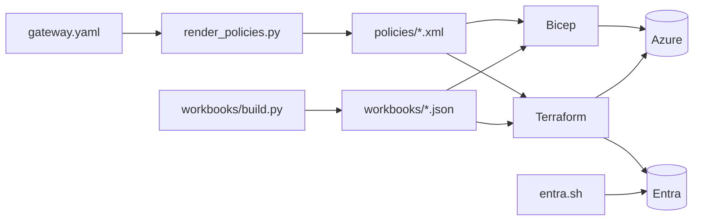

# 11 · Infrastructure as code: Bicep and Terraform

*How the whole thing is described, generated and deployed.*

Three generators feed the deployment: `render_policies.py` (gateway.yaml → APIM policy XML),
`infra/workbooks/build.py` (→ workbook JSON) and `teams/package.py` (→ Teams app zip). You can
deploy with **Bicep** (`infra/main.bicep`) plus `entra.sh` for the app registrations, or with
**Terraform** (`terraform/`), which does both in one: `azurerm` for resources, `azuread` for
Entra, `azapi` where azurerm can't express something exactly.



## Steps

!!! example "Run: regenerate policies from config"
    ```bash
    uv run python deploy/agent-gateway/render_policies.py deploy/agent-gateway/gateway.example.yaml --check \
      && echo "policies match the example config"
    ```

!!! example "Run: validate the Terraform"
    ```bash
    (cd deploy/agent-gateway/terraform && terraform init -backend=false && terraform validate)
    ```

!!! example "Run: see what Terraform would create (plan only, nothing changes)"
    ```bash
    (cd deploy/agent-gateway/terraform && terraform plan -lock=false -out=/dev/null \
      -var subscription_id=$(az account show --query id -o tsv) -var resource_group_name=rg-agw-tf-plan-only \
      -var prefix=agwtf -var publisher_email=platform-team@your-org.example | tail -5)
    ```
    `Plan: 47 to add` for a first apply (no container images yet).

!!! example "Run: the whole test suite"
    ```bash
    uv run pytest -q
    ```
    About 180 tests, all offline, in a few seconds.

??? question "Check: why do policies go through azapi instead of azurerm's api_policy?"
    azurerm sends policies as `rawxml`; the generator emits properly escaped XML
    (`&lt;JObject&gt;`), which must be sent as `xml`. azapi sends the exact ARM body, the same
    as the Bicep.

[Next: wrap-up and teardown →](12-wrap-up.md)
