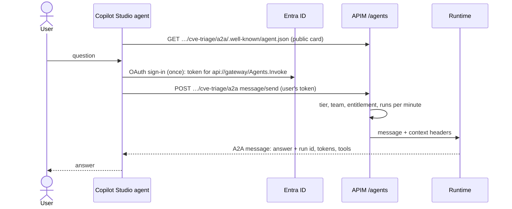

# 12 · Copilot Studio: a supported front end over A2A

*Microsoft's agent builder uses your gateway agents as connected agents.*

**Copilot Studio** is Microsoft's supported product for building, testing, publishing (Teams,
Microsoft 365 Copilot, a website) and analysing agents. It can connect to agents hosted
elsewhere through the open **Agent2Agent (A2A)** protocol. You give it an endpoint URL, and your
Copilot Studio agent delegates to that agent when a question fits.

The gateway speaks A2A at `/agents/<agent>/a2a`. Copilot Studio sends JSON-RPC `message/send`
requests with the chat history and a stable `contextId`. The runtime uses the history as
context and the `contextId` as the session, then answers with an A2A message. Each user signs
in once through OAuth 2.0, so the gateway sees *them*: the same entitlements, token limits,
metrics and traces as the CLI or the web chat.



| Term | Meaning |
|---|---|
| A2A | Agent2Agent: an open protocol for one agent to hand a task to another and get a structured answer back. |
| Agent card | A small public JSON document (name, description, skills) at `…/.well-known/agent.json`. It's the one gateway route that needs no token. |
| `contextId` | Copilot Studio's id for a conversation. The runtime uses it as the session id, so the run explorer groups a Copilot Studio conversation together. |

!!! note "Needs the Copilot Studio client"
    The OAuth client app exists only if you deployed with `enable_copilot_studio = true`.
    The A2A endpoints work either way.

## Steps

!!! example "Run: read the public agent card, without a token"
    ```bash
    curl -s $AGW_GATEWAY_URL/agents/cve-triage/a2a/.well-known/agent.json | python3 -m json.tool
    ```
    You get the name, the description, the A2A **url**, and one skill listing the tools. There
    are no instructions or secrets in it.

!!! example "Run: send an A2A message the way Copilot Studio does"
    ```bash
    T=$(az account get-access-token --scope "api://$AGW_GATEWAY_APP_ID/.default" --query accessToken -o tsv)
    curl -s -X POST $AGW_GATEWAY_URL/agents/cve-triage/a2a \
      -H "Authorization: Bearer $T" -H "content-type: application/json" \
      -d '{"jsonrpc":"2.0","id":"1","method":"message/send","params":{"message":{"role":"user","contextId":"my-a2a-test","parts":[{"kind":"text","text":"Prioritise CVE-2024-3400"}]}}}' \
    | python3 -c "import sys,json; r=json.load(sys.stdin)['result']; print(r['metadata']); print(r['parts'][0]['text'][:600])"
    ```
    After about 20–30 seconds you get the run id, the tokens and tools used, and the triage
    answer. Search the run explorer (module 09) for session **my-a2a-test**.

!!! example "Run: the same call without a token is refused"
    ```bash
    curl -s -o /dev/null -w "HTTP %{http_code}\n" -X POST -H "content-type: application/json" \
      -d '{"jsonrpc":"2.0","id":1,"method":"message/send","params":{"message":{"role":"user","parts":[{"kind":"text","text":"hi"}]}}}' \
      $AGW_GATEWAY_URL/agents/cve-triage/a2a
    ```
    **HTTP 401**: only the card is public.

!!! info "Look: the OAuth client Copilot Studio signs users in with"
    ```bash
    export CS_APP_ID=$(az ad app list --display-name "agent-gateway-copilot-studio$ENTRA_SUFFIX" --query "[0].appId" -o tsv)
    az ad app show --id $CS_APP_ID --query "{redirects:web.redirectUris, secrets:length(passwordCredentials)}"
    ```
    It has delegated `Agents.Invoke` with tenant-wide consent, the Power Platform redirect URI,
    and **no secret yet**. Copilot Studio requires one, so create it under **Certificates &
    secrets** when you set up the connection, and give it a short expiry.

!!! info "Look: connect it in Copilot Studio (needs a licence or trial on a member account)"
    In [Copilot Studio](https://copilotstudio.microsoft.com), open your agent → **Agents** →
    **Add agent** → **A2A agent**, and enter these values. Then create the connection (you sign
    in once) and try it in the test canvas.

    | Field | Value |
    |---|---|
    | Endpoint URL | `echo $AGW_GATEWAY_URL/agents/cve-triage/a2a` |
    | Authentication | OAuth 2.0 |
    | Client ID | `echo $CS_APP_ID`, plus the secret you created |
    | Authorization URL | `echo https://login.microsoftonline.com/$TENANT_ID/oauth2/v2.0/authorize` |
    | Token / Refresh URL | `echo https://login.microsoftonline.com/$TENANT_ID/oauth2/v2.0/token` |
    | Scope (if asked) | `echo "api://$AGW_GATEWAY_APP_ID/Agents.Invoke offline_access"` |

??? question "Check: Copilot Studio is a Microsoft service calling your gateway. Why do per-user limits still work?"
    It calls with each **user's** token, which it gets through the OAuth 2.0 connection the
    user signs in to. It doesn't use an identity of its own. The front door reads that token's
    groups exactly as it does for the CLI, so tier, team, entitlement and limits all apply. A
    refused run comes back as a "⏳" or "🔒" answer in the conversation.

More detail: [Copilot Studio (A2A)](../agent-gateway.md#copilot-studio-a2a).

[Next: wrap-up and teardown →](13-wrap-up.md)
