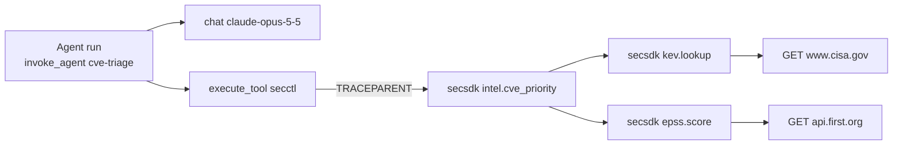
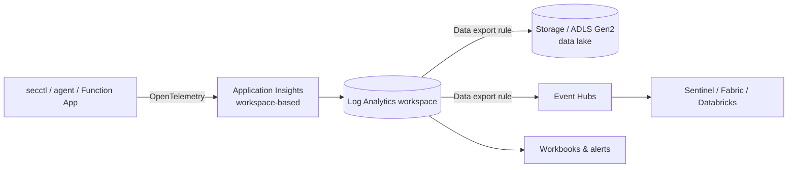

# Observability

secsdk emits **OpenTelemetry** traces and metrics for every operation and every
upstream HTTP request. Telemetry is off until you choose a destination. The SDK
itself depends only on the OpenTelemetry API, so it adds no overhead when unused.



One trace follows a request from the agent, through the `secctl` subprocess, down to each
API call. `secctl` joins its caller's trace through the standard `TRACEPARENT` variable.

## Turn it on

| Destination | Install | Set |
|---|---|---|
| **Azure Monitor / Application Insights** | `pip install 'secsdk[azure-monitor]'` | `APPLICATIONINSIGHTS_CONNECTION_STRING` |
| **Any OTLP backend** (Collector, Grafana, Datadog, Honeycomb, …) | `pip install 'secsdk[otlp]'` | `OTEL_EXPORTER_OTLP_ENDPOINT` (+ `OTEL_EXPORTER_OTLP_HEADERS`) |
| **Local JSON-lines file** | `pip install 'secsdk[otlp]'` | `SECSDK_TELEMETRY_FILE=~/secsdk-spans.jsonl` |

In this repository, `uv sync` already includes the OpenTelemetry SDK. To try it:

```bash
SECSDK_TELEMETRY_FILE=/tmp/spans.jsonl uv run secctl intel cve-priority CVE-2023-4966 --no-nvd
jq -c '{name, parent: .parent_id, attrs: .attributes}' /tmp/spans.jsonl
```

`secctl doctor` shows whether telemetry is installed, enabled, and which exporter it will use.

Applications call `secsdk.telemetry.configure()` once at start-up, as `secctl`, the agent
example and the Function App do. Libraries that embed secsdk should not call it; they should
let the host application configure OpenTelemetry.

## What is recorded

### Spans

| Span | Kind | Key attributes |
|---|---|---|
| `secsdk <provider>.<operation>` | internal | `secsdk.operation`, `secsdk.provider`, `secsdk.params` (names only), `secsdk.outcome` (`ok` or error code), `secsdk.result.count`, `error.type` |
| `<METHOD> <host>` | client | `http.request.method`, `server.address`, `url.path`, `http.response.status_code`, `http.request.resend_count`, `secsdk.cache_hit` |
| `invoke_agent <workflow>` (agent example) | internal | `gen_ai.agent.name`, `gen_ai.request.model`, `gen_ai.usage.*`, `secctl_agent.stop`, `secctl_agent.commands` |
| `chat <model>` (agent example) | internal | `gen_ai.provider.name`, `gen_ai.response.finish_reasons`, `gen_ai.usage.input_tokens/output_tokens` |
| `execute_tool secctl` (agent example) | internal | `gen_ai.tool.name`, `secctl.command`, `secctl.exit_code`, `secctl.blocked` |

Composite operations nest: `intel.cve_priority` contains `kev`, `epss` and `nvd` spans.
Failed spans carry `error.type` with the same code the CLI returns (`not_found`, `not_configured`, …).

### Metrics

| Metric | Type | Attributes |
|---|---|---|
| `secsdk.operation.calls` | counter | `secsdk.operation`, `secsdk.provider`, `secsdk.outcome` |
| `secsdk.operation.duration` | histogram (s) | same |
| `secsdk.http.requests` | counter | `http.request.method`, `server.address`, `http.response.status_code`, `secsdk.cache_hit` |
| `secsdk.http.duration` | histogram (s) | same |
| `secsdk.http.retries` | counter | same |

### Privacy defaults

- Parameter **names** are recorded; **values** (domains, KQL, CVE lists) are not, unless
  `SECSDK_TELEMETRY_CAPTURE_PARAMS=true`.
- Query strings are never recorded, only `url.path`. API keys travel in headers, which are never recorded.
- `SECSDK_TELEMETRY=off` disables all instrumentation, even if an exporter is configured.

## Azure: Application Insights to a data lake



1. **Create a workspace-based Application Insights resource** and copy its connection string.
2. **Send telemetry:** set `APPLICATIONINSIGHTS_CONNECTION_STRING` wherever secctl, your agents
   or the Function App run. In Azure Functions, use the platform settings described in
   [Deploy to Azure](deploy-azure.md#telemetry) instead.
3. **Query it** in Log Analytics. Azure Monitor stores client and internal spans in
   `AppDependencies` (internal spans have `DependencyType == "InProc"`), and metrics in
   `AppMetrics`. Span attributes are in the `Properties` column.

    ```kusto
    // Operation volume, failures and p95 latency by operation, last 24h
    AppDependencies
    | where TimeGenerated > ago(24h) and Name startswith "secsdk "
    | extend op = tostring(Properties["secsdk.operation"]), outcome = tostring(Properties["secsdk.outcome"])
    | summarize calls = count(), failures = countif(outcome != "ok"),
                p95_ms = percentile(DurationMs, 95) by op
    | order by calls desc
    ```

    ```kusto
    // Upstream health: error rate and retries per API host
    AppDependencies
    | where TimeGenerated > ago(24h) and DependencyType != "InProc"
    | extend retries = toint(Properties["http.request.resend_count"])
    | summarize requests = count(), errors = countif(Success == false), retries = sum(retries) by Target
    ```

4. **Land it in your data lake** with a Log Analytics **data export rule** (continuous export
   of chosen tables to a Storage account / ADLS Gen2 or Event Hubs):

    ```bash
    az monitor log-analytics workspace data-export create \
      --resource-group <rg> --workspace-name <law> --name secsdk-to-lake \
      --tables AppDependencies AppRequests AppMetrics \
      --destination <storage-account-resource-id>
    ```

    From Event Hubs, the same stream can feed Microsoft Sentinel, Fabric, or Databricks.

!!! tip "Not on Azure Monitor?"
    Point `OTEL_EXPORTER_OTLP_ENDPOINT` at an **OpenTelemetry Collector**. The Collector can
    fan out to several backends (and to Azure Monitor via its `azuremonitor` exporter), and
    can write files to object storage for a lake.

## Agent audit trail

Independently of OpenTelemetry, the agent example writes a `.commands.json` file per run.
It records every `secctl` command, the agent's stated reason, exit code, timing and token
usage. Upload it to blob storage as-is if you need a plain audit trail without a telemetry backend.
